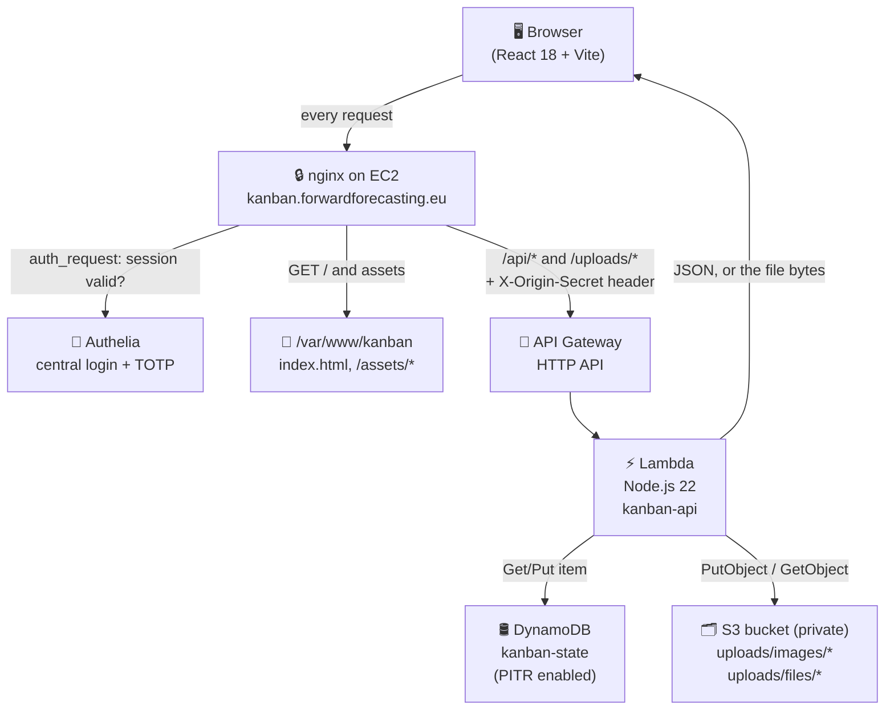

# Kanban Board

A private, cross-device Kanban board with drag-and-drop task management, file attachments, and a month-view calendar — deployed as a fully serverless app at **[kanban.forwardforecasting.eu](https://kanban.forwardforecasting.eu/)**.

---

## Table of Contents

1. [Overview](#overview)
2. [Features](#features)
3. [Data Flow](#data-flow)
4. [Tech Stack & Libraries](#tech-stack--libraries)
5. [Architecture](#architecture)
6. [AWS Cost Estimation](#aws-cost-estimation)

---

## Overview

A personal Kanban board built for single-user private use, accessible from any device. Tasks live in four columns (To Do, In Progress, Done, Backlog) and can carry rich metadata: categories with custom colors, urgency levels, due dates, start/end datetimes, location links, images, PDF/TXT/CSV attachments, and URL links. All state is persisted in DynamoDB and synced across devices in real time.

---

## Features

- **Drag-and-drop** between columns via `@hello-pangea/dnd`
- **Post-it cards** — full background color driven by user-defined categories
- **3 urgency levels** — Today / This Week / This Month
- **Backlog** — staging area with one-click promotion to any column
- **Rich card metadata** — links, images (compressed client-side), PDF/TXT/CSV attachments with inline viewer, location map link, start/end datetimes
- **Calendar view** — month grid showing tasks by completion date
- **Central login** - private service behind the shared portal for all private services (password + Google Authenticator); the app has no login of its own
- **Cross-device sync** — DynamoDB as single source of truth, debounced push on every state change
- **File drive** — all uploads browsable at `drive.forwardforecasting.eu`

---

## Data Flow



### Processing steps

| Step | Where | What happens |
|---|---|---|
| Login | nginx + Authelia | Every path (app, API, attachments) requires the central session; logged out, nginx redirects to `https://forwardforecasting.eu/auth/` |
| Trust check | Lambda | Only requests carrying the `X-Origin-Secret` that nginx adds are served (constant-time compare, refused if the secret is unset); direct API Gateway calls get 401 |
| State load | Lambda → DynamoDB | Full `AppState` JSON fetched; client merges with localStorage (most tasks wins) |
| Image upload | Browser → Lambda → S3 | Canvas API resizes to max 1200 px, JPEG 0.82; base64 POSTed; Lambda writes to the private bucket and returns a `kanban.forwardforecasting.eu/uploads/...` URL |
| File upload | Browser → Lambda → S3 | FileReader base64; Lambda writes PDF/TXT/CSV to `uploads/files/`; returns URL |
| Attachment view | nginx → Lambda → S3 | `/uploads/<key>` is rewritten to `/api/file?key=...`; the Lambda streams the object (the bucket is never public) |
| State push | Lambda → DynamoDB | Entire `AppState` JSON stored under the board's key; debounced 1.5 s after every change |
| Drag-and-drop | Browser only | `@hello-pangea/dnd` reorders in-memory state; triggers debounced sync |

---

## Tech Stack & Libraries

### Frontend

| Library | Version | Purpose |
|---|---|---|
| **React** | 18 | UI component tree, hooks-based state management |
| **Vite** | 5 | Dev server and production bundler (ESM, content-hashed assets) |
| **TypeScript** | 5 | Static typing across all source files |
| **@hello-pangea/dnd** | 17 | Accessible drag-and-drop for the Kanban columns (fork of `react-beautiful-dnd`) |

> This project does **not** use AI, LLM, GenAI, speech-to-text, image diffusion, image classification, chatbots, RAG, Kafka, GraphQL, Kubernetes, or FastAPI. It is a pure task-management tool with no ML components.

### Backend (Lambda)

| Library | Purpose |
|---|---|
| **@aws-sdk/client-dynamodb** | Read/write app state |
| **@aws-sdk/util-dynamodb** | `marshall` / `unmarshall` helpers |
| **@aws-sdk/client-s3** | Store, list and stream uploaded files |
| **Node.js `crypto`** | `timingSafeEqual` for the shared-secret check |

---

## Architecture

```
kanban.forwardforecasting.eu
        │
        ▼
  EC2 nginx (shared host) ── auth_request ──► Authelia (central login + TOTP)
  ┌──────────────────────────────────────────┐
  │  /         ──► /var/www/kanban (static)  │
  │  /api/*    ──► API Gateway ─► Lambda     │
  │  /uploads/*──► /api/file ─► Lambda       │
  │               (adds X-Origin-Secret)     │
  │                 ├─► DynamoDB             │
  │                 └─► S3 (private)         │
  └──────────────────────────────────────────┘

drive.forwardforecasting.eu
        │
        ▼
  EC2 (nginx) ──► Streamlit :8504
  (cloud-drive backup monitor)
```

**Key design decisions:**

- **One front door** - since 2026-10-15 the static app is served by nginx on the shared EC2 host behind the central login, like every private service. The previous S3 + CloudFront hosting (distribution `E1AQDWOGNRBTEY`, now disabled) made attachments downloadable by anyone with the link, and the app's own login had no lockout and 30-day tokens.
- **Serverless API kept** - Lambda + API Gateway + DynamoDB stay; nginx forwards `/api/` with a shared secret header so the API is only usable through the login.
- **Single DynamoDB item** - the whole board state is one JSON blob; simple, cheap, no query complexity.
- **Client-side image compression** - reduces upload size by ~60-80% before the base64 round-trip through API Gateway (10 MB body limit).
- **Merge strategy** - on load, whichever side (local vs remote) has more tasks wins; prevents accidental overwrites from a fresh browser session.

---

## AWS Cost Estimation

Usage assumptions: 1 user, ~2 sessions/day, ~200 API calls/day, ~500 MB uploads total.

### Monthly

| Service | Resource | Est. cost |
|---|---|---|
| **EC2 (shared host)** | static files served by the existing nginx; no extra instance | $0.00 *(marginal)* |
| **S3** | ~500 MB storage + 10 K requests | $0.02 |
| **Lambda** | ~6 K invocations × 200 ms × 256 MB (attachments now stream through it) | $0.00 *(free tier)* |
| **API Gateway** | ~6 K HTTP requests | $0.01 |
| **DynamoDB** | ~6 K RCU/WCU on-demand + PITR ~0.01 GB | $0.20 |
| **Route 53** | one A record in the existing zone | $0.00 |
| **TLS** | Let's Encrypt on the host | $0.00 |
| **Total** | | **≈ $0.23 / month** |

### Yearly

| | |
|---|---|
| **Estimated annual cost** | **≈ $2.80 / year** |

> Costs scale with upload volume: 10 GB of uploads adds ~$0.23/month in S3 storage. Data transfer now leaves through the EC2 host (first 100 GB/month free across the account). Moving off CloudFront saved ~$0.18/month. RAM on the shared host: none extra (static files only).

---

*Deployed with React 18 + Vite · Lambda Node.js 18 · DynamoDB · S3 · CloudFront*
